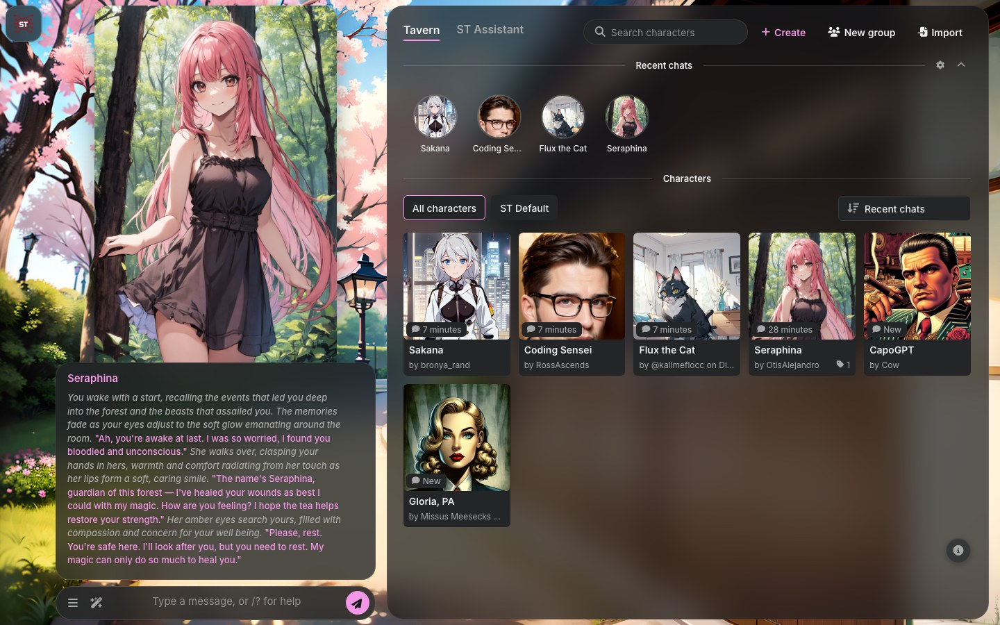
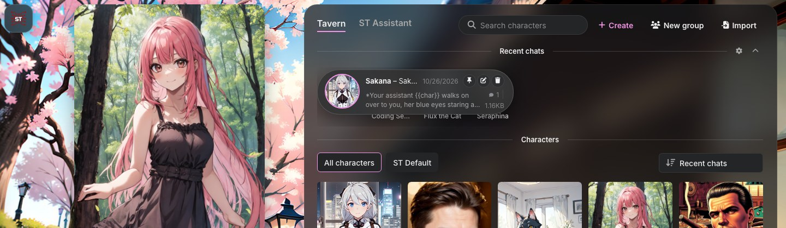
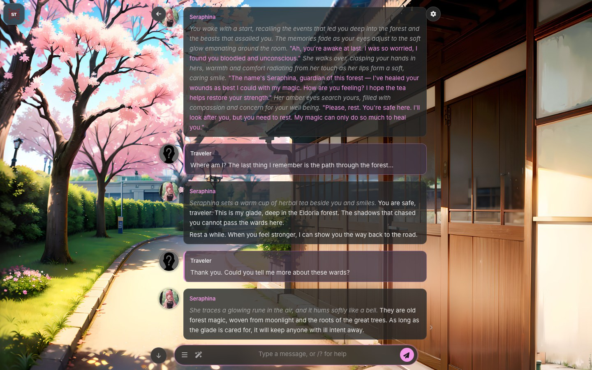
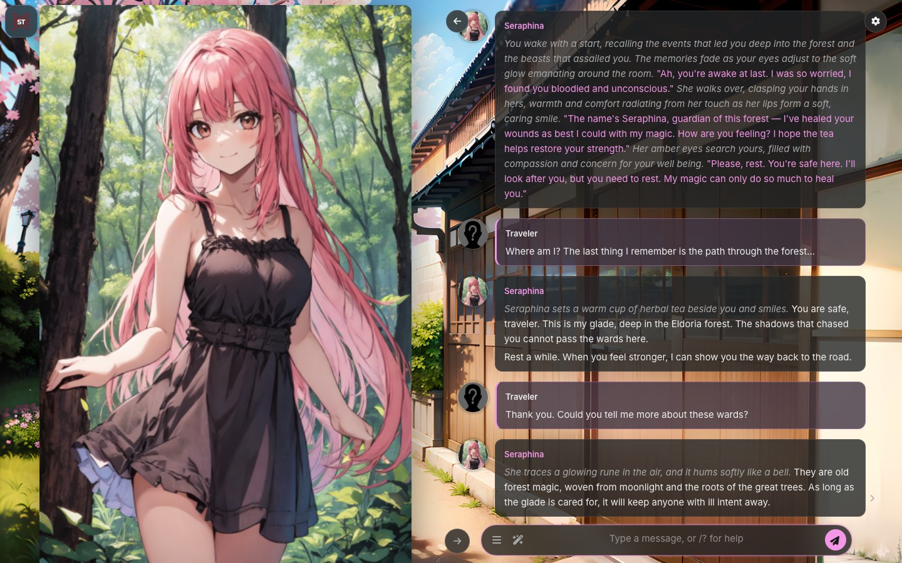
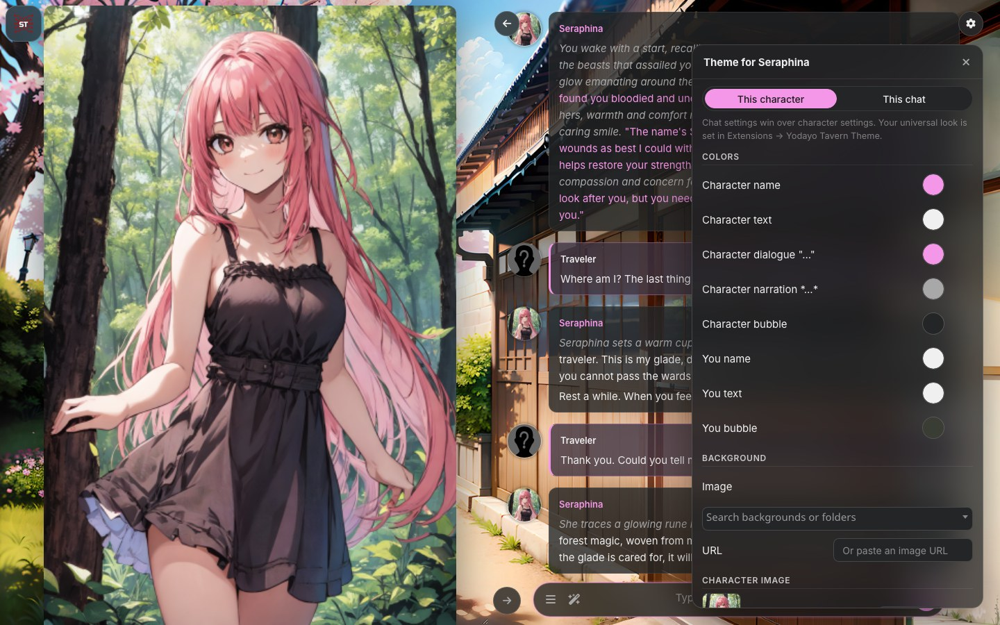
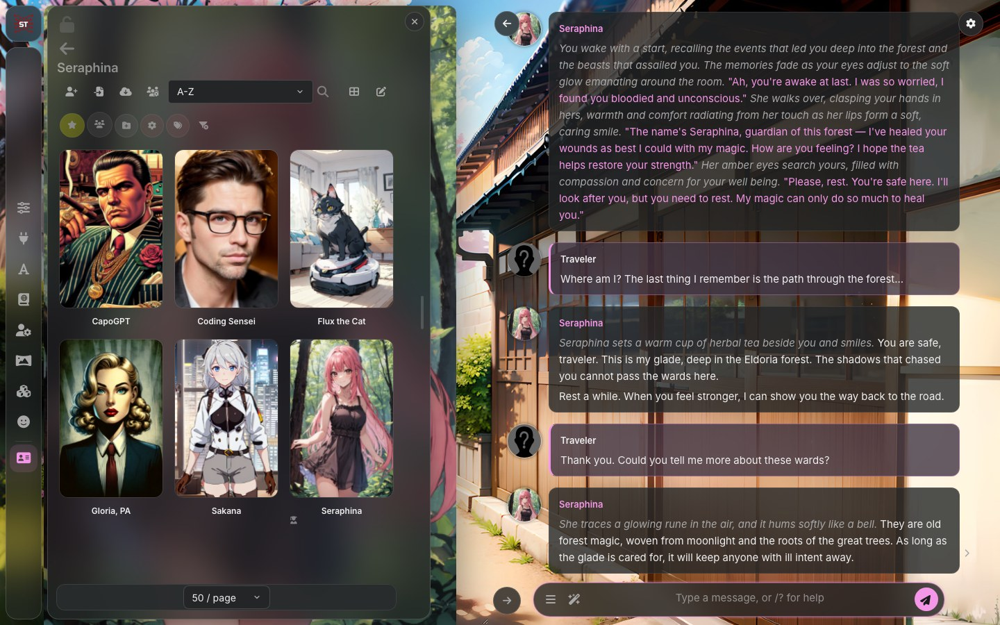
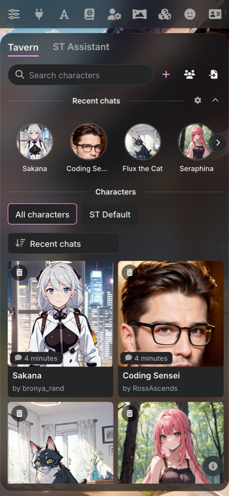
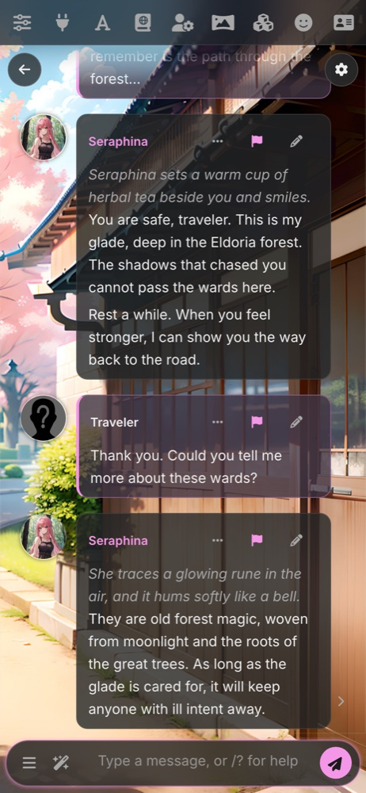
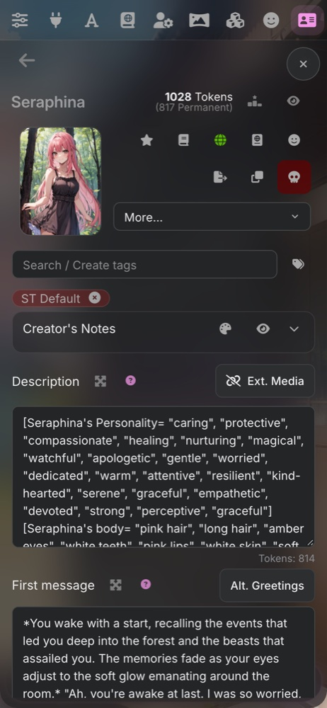
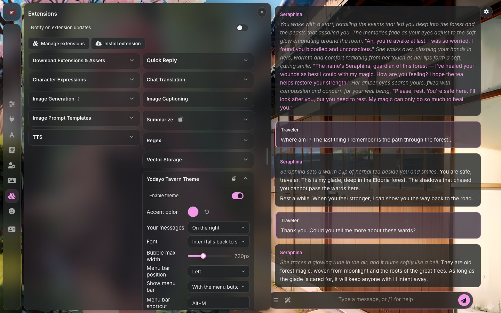

# Yodayo Tavern Theme for SillyTavern

A SillyTavern extension that restyles the whole UI after the Yodayo / Moescape Tavern:
a character browser for a home page, frosted chat bubbles straight on your background, a
Yodayo-pink accent, Inter type, a menu bar on any edge with drawers as side sheets, and
per-character looks.



Built and tested against **SillyTavern 1.19.0**.

## Features

### Tavern home

The welcome screen becomes a Yodayo-style Tavern window: search, Create / New group / Import,
tag chips, a sort order and a grid of portrait cards for every character and group. Hover a
card to delete it (with SillyTavern's usual confirmation). Your welcome assistant stands
beside it with its greeting over the message box; sending a message opens its chat like
normal. If the assistant has a cutout made with Remove background, the cutout is shown.

Recent chats sit above the characters as a row of circles. Rest the pointer on one for a
second and it opens into a card with the chat's name, date, size and pin / rename / delete.



### Chat

Frosted bubbles straight on your background, names and quotes in the accent color, yours on
the right. Dock the chat in the middle, on the left or on the right with the round arrow
button beside the message box; docked to a side, the character stands on the other side, at
full height when the picture is large enough.

| Chat in the middle | Chat on the right |
| --- | --- |
|  |  |

### Looks per character and per chat

The cog at the top right of a chat opens **Theme for &lt;character&gt;**: colors, a
background, the character image (upload, URL or **Remove background**), message style and
background effects, for this character or only this chat. Every change applies as you type
or drag.



### Menus

SillyTavern's menus open as frosted acrylic side sheets beside the menu bar, like the Tavern window, and each one remembers
its width. The character list shows portrait cards in grid view, and every avatar is
pre-scaled to its on-screen size so it stays sharp.



### Phones

On phones the menu bar is a single frosted row across the top that clears the notch, with
the open menu's icon highlighted. Menus open full width beneath it, the Tavern window fits
the screen with two cards across, and nothing runs off the side.

| Home | Chat | Character menu |
| --- | --- | --- |
|  |  |  |

Also: switch toggles, modern sliders and fields, popover menus, focus rings and readable
contrast throughout; readable find-in-page highlights; and dragging an image already on the
page no longer imports it as a new character.

## Install

1. In SillyTavern open **Extensions** (the stacked-cubes icon in the top bar).
2. Click **Install extension** and paste:
   ```
   https://github.com/pervertir/SillyTavern-YodayoTavernTheme
   ```
3. Reload the page. The theme turns on straight away.

To install by hand, clone this repo into
`SillyTavern/public/scripts/extensions/third-party/` and reload.

### Background removal (optional)

The **Remove background** button in the chat look editor cuts the character image out of
its background with [ToonOut](https://huggingface.co/joelseytre/toonout) (BiRefNet
fine-tuned for anime). Extensions can't run code outside the browser, so this runs on your
machine in a separate server plugin,
[Background Removal](https://github.com/pervertir/SillyTavern-BackgroundRemoval). The rest
of the theme works without it.

1. Set `enableServerPlugins: true` in SillyTavern's `config.yaml`.
2. In SillyTavern's `plugins` folder:
   ```
   git clone https://github.com/pervertir/SillyTavern-BackgroundRemoval
   cd SillyTavern-BackgroundRemoval
   npm install
   ```
3. Restart SillyTavern.

The plugin runs on NVIDIA (CUDA), any GPU on Windows (DirectML), Apple silicon (Metal) and
AMD or Intel on Linux (Vulkan), and falls back to the CPU. The first cutout downloads its
974 MB model. Without the plugin, the button shows these steps.

## Settings

Open **Extensions → Yodayo Tavern Theme**:



| Setting | What it does |
| --- | --- |
| Enable theme | Turns the whole look on or off without uninstalling. |
| Accent color | Recolors the send button, names, quotes and highlights. Reset returns to Yodayo pink. |
| Your messages | Put your bubbles on the right (Yodayo style) or the left. |
| Font | Inter (falls back to the system font), the system UI font, or SillyTavern's default. |
| Bubble max width | How wide a chat bubble may grow on desktop. |
| Bubble opacity | How see-through chat bubbles and the message box are (default 80%). |
| Tavern home page | Turns the welcome screen into a Yodayo-style character browser: recent chats, search, tag chips and a grid of character and group cards. An ST Assistant tab opens a chat with SillyTavern's assistant, and New group starts a group chat. |
| Menu bar position | Put SillyTavern's menu bar on the left, right, top or bottom edge (desktop; phones keep SillyTavern's top bar). Menus open beside it. |
| Show menu bar | Always; with the SillyTavern-logo menu button in the nearest corner; with a small arrow tab on its edge; or on hover at its edge (auto-hide). |
| Menu bar shortcut | A key combination that shows or hides the menu bar, Alt+M by default. |
| Menu width | Each menu opens at a width that suits it (for example 440px for AI settings, 820px for User Settings). Drag an open menu's edge to resize it; each menu remembers its own width. Double-click the edge to reset. |
| Colors | Character name, text, dialogue ("quotes"), narration (*actions*) and bubble, plus your name, text and bubble. Set them for all characters, or for only the open character to override. |
| Character image | With "Only this character" selected, an image URL to show instead of the card art on the free side. |
| Advanced | Every look setting Moonlit Echoes offers that applies to this theme, in groups: theme colors (secondary color, menu, menu bar, icon, chat field and scrollbar colors), message style (avatar size, spacing, name and text sizes, line height, context marker), background effects (blur, opacity, chat field blur), theme extras, chat (edge fade, justified text, hidden message details, favorite symbol), visual novel mode, phones and tablets, and raw CSS. |
| Pop-out | The window icon in the panel's header opens these settings in a floating window you can drag around. |
| Reset everything | Puts every theme setting back to its default after asking first. |
| Chat look editor | The cog at the top right of an open chat sets colors, a background, the character image (upload or URL), message style and background effects for this character or only this chat. Chat settings win over character settings, which win over the universal settings in this panel. |
| Export / Import | Save all theme settings, including per-character colors, to a JSON file and load them back. |
| Chat position | Dock the chat window on the left, in the middle, or on the right. Also available from the round arrow button just left of the message box. |
| Show character image | With the chat on the left or right, shows the character's image on the free side, at full height when the image is large enough. |
| Hide chat background image | Hides your background for a flat Yodayo look. |

### Chat position

With the chat docked to one side, the character appears on the other. If you use
Character Expressions, the expression sprite moves there. Otherwise the extension
shows the character's card image. Group chats and Visual Novel mode keep their own
layout, and on phones the chat always fills the screen.

### Chat styles and visual novel mode

The theme follows SillyTavern's **Chat Style** setting (User Settings):

- **Bubbles:** Yodayo-style bubbles, yours on the right.
- **Flat:** full-width message rows; yours have an accent stripe.
- **Document:** one centered reading page with book-style text.

With **Visual Novel Mode** on, the chat becomes a centered panel along the bottom (80% wide,
30% tall) and the character stands above it, using the expression sprite when there is one.
Drag the bar on the chat's top edge to give the chat or the image more room; the split is
remembered.

## Palette

| Role            | Color                       |
| --------------- | --------------------------- |
| Background      | `#1a1c1e`                   |
| Surface         | `#232527`                   |
| Raised surface  | `#2c2e30`                   |
| Text            | `#f0f0f0`                   |
| Muted text      | `#a8a8a8`                   |
| Accent          | `#f597e8` (Yodayo pink)     |
| Hairline border | `rgba(230, 230, 230, 0.1)`  |

## Notes

- **Other theme extensions:** Moonlit Echoes and similar extensions restyle the same
  elements with `!important` rules, so the two will fight. Disable the other one in
  **Manage extensions** while using this theme. The settings panel warns you when
  Moonlit Echoes is active.
- **Theme presets:** the extension overrides SillyTavern's theme colors while it is
  enabled, so any built-in theme preset works underneath it.
- **Font:** Inter isn't bundled. Install it locally for an exact match, otherwise
  the system UI font is used.

## Development

- `manifest.json`: extension metadata
- `index.js`: settings panel and the body classes / CSS variables it controls
- `settings.html`: the settings panel markup
- `home.js`: the Tavern home page on the welcome screen
- `vn.js`: the visual novel layout's resize handle
- `sheets.js`: drag handles that resize the menus
- `sliders.js`: keeps each slider's fill in step with its value
- `swipes.js`: marks single-swipe messages so their counter can hide
- `advanced.js`: the Advanced settings and how each one is applied
- `popout.js`: the floating settings window
- `pagination.js`: moves page controls below their lists
- `charsettings.js`: the chat's cog and its per-character / per-chat look editor
- `avatars.js`: pre-scales chat and character list avatars so they stay sharp
- `bgremove.js`: Remove background, through the Background Removal server plugin
- `colors.js`: chat colors (all characters or per character), character image and export/import
- `style.css`: imports the theme modules in `css/` (tokens, navigation, controls, chat,
  composer, lists, overlays, layout). Every rule is scoped under `body.yodayo-tavern`.

To work on it live, clone the repo straight into
`SillyTavern/public/scripts/extensions/third-party/` and reload SillyTavern after edits.

## License

MIT. See [LICENSE](LICENSE).
